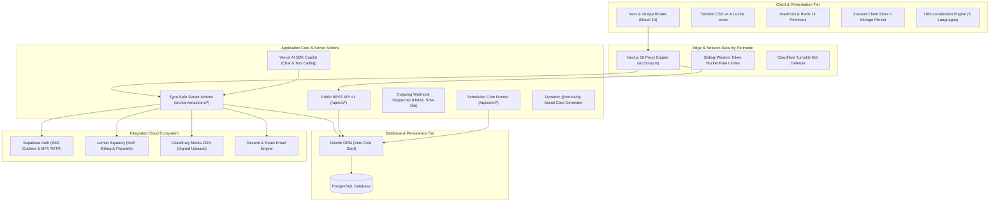

# Imperial 🚀

<div align="center">

[](https://github.com/som2077/saas-kit-website/actions/workflows/ci.yml)
[](https://github.com/som2077/saas-kit-website/releases)
[](https://github.com/som2077/saas-kit-website/stargazers)
[](https://github.com/som2077/saas-kit-website/network/members)
[](https://opensource.org/licenses/MIT)

[](https://nextjs.org/)
[](https://react.dev/)
[](https://tailwindcss.com/)
[](https://supabase.com/)
[](https://orm.drizzle.team/)
[](https://www.lemonsqueezy.com/)
[](https://playwright.dev/)
[](https://www.typescriptlang.org/)

<p align="center">
  <b>The Official Commercial Sales Platform, Docs Hub & License Delivery Engine for SaaS Kit.</b><br>
  Engineered with Next.js 16 App Router, Lemon Squeezy Webhooks, automated GitHub collaborator invites, and full support for both Web ($50) and Mobile ($50) templates.
</p>

[Web Template](https://github.com/som2077/saas-kit-template) •
[Mobile Template](https://github.com/som2077/saas-mobile-template) •
[GitHub Discussions](https://github.com/som2077/saas-kit-website/discussions) •
[Issue Tracker](https://github.com/som2077/saas-kit-website/issues)

</div>

---

### 📑 Quick Navigation

- [⚡ Feature Highlights & Commercial Parity](#-feature-highlights--commercial-parity)
- [🏆 Commercial Boilerplate Comparison](#-commercial-boilerplate-comparison)
- [🏗️ System Architecture & Diagram](#️-system-architecture--diagram)
- [🚀 Quick Start Guide (3 Minutes)](#-quick-start-guide)
- [🔄 Staying Updated with Upstream Releases](#-staying-updated-with-upstream-releases)
- [🛠️ Developer CLI Tooling Reference](#️-developer-cli-tooling-reference)
- [📖 Developer Documentation Hub](#-developer-documentation-hub)
- [🌐 Internationalization (i18n) Engine](#-internationalization-i18n-engine)
- [🎯 Interactive Onboarding Wizard](#-interactive-onboarding-wizard)
- [🖼️ Dynamic OpenGraph Image Engine](#️-dynamic-opengraph-image-engine)
- [📝 Enterprise Audit Logs & Compliance](#-enterprise-audit-logs--compliance)
- [🤖 Built-in MCP Server for AI Agents](#-built-in-mcp-server-for-ai-agents)
- [🔒 Security Architecture](#-security-architecture)
- [🚢 Production Deployment](#-production-deployment)
- [🤝 Contributing & Community](#-contributing--community)

---

## ⚡ Feature Highlights & Commercial Parity

| Feature Category                   | Capabilities & Implementation Details                                                                                                                          |
| :--------------------------------- | :------------------------------------------------------------------------------------------------------------------------------------------------------------- |
| **Framework & Engine**             | Next.js 16 App Router, React 19, Turbopack, Server Actions, Next 16 Network Proxy (`src/proxy.ts`)                                                             |
| **Authentication & Auth Security** | Supabase SSR (`@supabase/ssr`), Passwords, Magic Links OTP, Google & GitHub OAuth, MFA TOTP with QR enrollment                                                 |
| **Bot & Fraud Protection**         | Cloudflare Turnstile Captcha (`<TurnstileCaptcha />`) with server-side token validation and dev-mode bypass                                                    |
| **Database & ORM**                 | PostgreSQL with Drizzle ORM, relational queries, connection pooling, zero cold starts, Drizzle Studio GUI                                                      |
| **Payments & Paywall Engine**      | Lemon Squeezy MoR, Customer Portal, `<Paywall />` component (card & blur modes) with subscription tier gating                                                  |
| **Interactive Onboarding Wizard**  | Sleek 4-step signup onboarding (`/onboarding`): Workspace Setup, Role Persona, Teammate Invitations, and Celebration                                           |
| **Enterprise Activity & Audit**    | Immutable audit trail (`/dashboard/activity`) tracking security events, team operations, and API key changes with CSV/JSON exports                             |
| **Dynamic OpenGraph (OG) Engine**  | Native `@vercel/og` ImageResponse (`/api/og`) generating on-the-fly 1200x630 branded social cards for Blog, Docs, and Landing                                  |
| **Developer Documentation Center** | 17 comprehensive guides (`/docs`) with categorized sidebar, syntax-highlighted code blocks, and prev/next pagination                                           |
| **Media & Storage Suite**          | Cloudinary signed client uploads, dynamic transformations (`f_auto,q_auto`), media manager (`/dashboard/media`), Supabase Storage avatars                      |
| **Internationalization (i18n)**    | Multilingual engine supporting **5 languages** (English, Spanish, German, French, Hindi), cookie sync, `<LanguageSwitcher />`                                  |
| **Background Cron Automations**    | Scheduled background task runner (`webhook-retries`, `trial-reminders`, `db-cleanup`), secure RFC route `/api/cron/[job]`, visual control room (`/admin/jobs`) |
| **Developer API Platform**         | Public REST API v1 (`/api/v1/me`, `/metrics`, `/events`), cryptographic hashed API keys (`sk_live_...`), token reveal modal                                    |
| **Outgoing Webhooks**              | User-configurable webhook endpoints (`/dashboard/webhooks`), HMAC SHA-256 signatures (`whsec_...`), live ping testing, delivery logs                           |
| **B2B Multi-Tenancy Workspaces**   | Interactive `<WorkspaceSwitcher />` dropdown, organization creation, RBAC roles (`owner`, `admin`, `member`), secure email invitations                         |
| **Super Admin Control Room**       | Platform KPIs (`/admin`), user management, 1-click customer impersonation for support, Email Studio (`/admin/emails`), Jobs Room (`/admin/jobs`)               |
| **AI Copilot & Generative UI**     | Vercel AI SDK v7 (`/dashboard/ai-studio`), interactive model switcher (`gpt-4o`, `o1-mini`), Chain-of-Thought accordions, live tool calling                    |
| **Upstream Feature Sync CLI**      | Built-in `npm run sync:upstream` assistant allowing developers to pull new official releases safely into an isolated branch                                    |
| **Standardized AI Agent Skills**   | `.agent/skills/` specifications (add feature, paywall, database change, i18n, emails) + built-in `npm run create:feature` CLI generator                        |
| **AI Agent MCP Server**            | Built-in Model Context Protocol server (`npm run mcp`) enabling Cursor, Claude Code, and Gemini CLI to introspect codebase                                     |
| **DDoS & Token Bucket Limiter**    | Sliding-window token bucket Rate Limiter protecting public APIs and AI streaming against abuse (HTTP 429)                                                      |
| **Transactional Email Studio**     | Resend + React Email templates (welcome, receipts, invites, magic links) with live visual inspector (`/admin/emails`)                                          |
| **Testing & Quality Assurance**    | Playwright E2E suite (**40/40 tests passing** across 12 test suites), ESLint 10, Prettier with Tailwind plugin, TypeScript Strict (`npm run check`)            |

---

## 🏆 Commercial Boilerplate Comparison

See how **SAAS-Kit** compares to popular commercial $200–$600 boilerplates:

| Feature & Architecture  |             SAAS-Kit              | Supastarter ($299+) |  ShipFast ($199+)   | MakerKit ($299+)  |
| :---------------------- | :-------------------------------: | :-----------------: | :-----------------: | :---------------: |
| **License & Price**     |      🚀 **100% Free (MIT)**       |   💸 $299 - $599    |   💸 $199 - $299    |     💸 $299+      |
| **Next.js & React**     |     **Next.js 16 + React 19**     |     Next.js 15      |    Next.js 14/15    |    Next.js 15     |
| **Bundler & Engine**    |    **Turbopack (Zero Config)**    | Webpack / Turbopack |       Webpack       |     Turbopack     |
| **Database & ORM**      | **Drizzle ORM (Zero Cold Start)** |  Prisma / Drizzle   | MongoDB / Supabase  | Prisma / Supabase |
| **Auth & Sessions**     |     **Supabase SSR Cookies**      |      Supabase       | NextAuth / Supabase |     Supabase      |
| **AI Copilot Studio**   |   **Vercel AI SDK v7 + Tools**    |    Basic Prompt     |        Basic        |       Basic       |
| **Media CDN Engine**    | **Cloudinary Signed + WebP/AVIF** |       ❌ None       |       ❌ None       |      ❌ None      |
| **Cron Automations**    | **RFC Route + `/admin/jobs` GUI** |       ❌ None       |       ❌ None       |      ❌ None      |
| **1-Click Rebranding**  |     **`npm run rename` CLI**      |       ❌ None       |       ❌ None       |      ❌ None      |
| **Setup Wizard**        |        **`npm run setup`**        |     ⚠️ Partial      |       ❌ None       |    ⚠️ Partial     |
| **Upstream Sync Tool**  |    **`npm run sync:upstream`**    |       ❌ None       |       ❌ None       |      ❌ None      |
| **AI Agent MCP Server** |   **Built-in (`npm run mcp`)**    |       ❌ None       |       ❌ None       |      ❌ None      |
| **Audit Logs (SOC2)**   |  **Included (CSV/JSON Export)**   | ⚠️ Enterprise only  |       ❌ None       |     ⚠️ Add-on     |
| **Automated E2E Tests** |   **40/40 Playwright Passing**    |     ⚠️ Partial      |       ❌ None       |    ⚠️ Partial     |

---

## 🏗️ System Architecture & Diagram

The diagram below illustrates the end-to-end dataflow and security perimeter:



---

## 🚀 Quick Start Guide

Launch your production-grade SaaS in less than 3 minutes:

### 1. Clone & Install

```bash
git clone https://github.com/som2077/saas-kit-website.git
cd SAAS-Kit
npm install
```

### 2. Fast-Track Interactive Setup (Recommended)

Run our automated 1-click wizard to initialize `.env.local`, verify Node.js compatibility, and optionally rebrand your project:

```bash
npm run setup
```

Or rebrand anytime directly via:

```bash
npm run rename
```

Or non-interactively via flags:

```bash
npm run rename -- --name "Apex AI" --short "Apex" --slug "apex-ai" -y
```

### 3. Configure Environment Variables

Open `.env.local` and configure your credentials:

- **Supabase**: `NEXT_PUBLIC_SUPABASE_URL` and `NEXT_PUBLIC_SUPABASE_ANON_KEY` from [supabase.com/dashboard](https://supabase.com/dashboard).
- **PostgreSQL Database**: `DATABASE_URL` (Supabase Connection Pooling on Port 6543 recommended).
- **Lemon Squeezy**: `LEMON_SQUEEZY_API_KEY`, `LEMON_SQUEEZY_STORE_ID`, `LEMON_SQUEEZY_WEBHOOK_SECRET`, and variant IDs.
- **Resend**: `RESEND_API_KEY` from [resend.com](https://resend.com).
- **Cloudinary (Optional)**: `CLOUDINARY_CLOUD_NAME`, `CLOUDINARY_API_KEY`, `CLOUDINARY_API_SECRET` from [cloudinary.com](https://cloudinary.com).
- **Cron Secret**: Set `CRON_SECRET` to any secure secret token.

### 4. Push Database Schema

Synchronize PostgreSQL tables directly via Drizzle Kit:

```bash
npm run db:push
```

To browse and inspect data via the visual Drizzle Studio UI:

```bash
npm run db:studio
```

### 5. Start Development Server

```bash
npm run dev
```

Navigate to [http://localhost:3000](http://localhost:3000) in your browser.

---

## 🔄 Staying Updated with Upstream Releases

One of the largest pain points with boilerplates is getting stuck on an old version while the official project ships bug fixes and new features. **SAAS-Kit solves this completely with our built-in Upstream Sync Assistant.**

### 1-Click Interactive Update Assistant

```bash
npm run sync:upstream
```

Or check for available updates without merging:

```bash
npm run sync:upstream -- --check
```

**What the Sync Assistant does automatically:**

1. Verifies or configures the `upstream` remote pointing to `https://github.com/som2077/saas-kit-website.git`.
2. Fetches the latest releases and displays a detailed commit log and file summary.
3. Creates a safe, timestamped branch (e.g., `upstream-sync-2026-10-11`) so your custom business logic is never touched or overwritten.
4. Merges `upstream/main` into the test branch so you can run `npm run check` and `npm run test:e2e` safely before adopting the update.

---

## 🛠️ Developer CLI Tooling Reference

| Command                  | Description                                                              |
| :----------------------- | :----------------------------------------------------------------------- |
| `npm run dev`            | Starts the Next.js 16 development server with Turbopack                  |
| `npm run build`          | Compiles the optimized standalone production build                       |
| `npm run start`          | Runs the compiled production server                                      |
| `npm run setup`          | Interactive 1-click first-time setup wizard                              |
| `npm run rename`         | Interactive CLI to rebrand project name, slug, email, and metadata       |
| `npm run sync:upstream`  | Interactive assistant to pull and merge new upstream releases safely     |
| `npm run create:feature` | Interactive generator to scaffold a new feature module from DB to UI     |
| `npm run mcp`            | Launches the built-in Model Context Protocol server for AI coding agents |
| `npm run check`          | Runs full codebase checks: ESLint + Prettier check + TypeScript Strict   |
| `npm run lint`           | Runs ESLint 10 rules across all TypeScript and React files               |
| `npm run format`         | Formats entire codebase using Prettier with Tailwind CSS plugin          |
| `npm run typecheck`      | Validates TypeScript types across the entire project (`tsc --noEmit`)    |
| `npm run test:e2e`       | Executes full Playwright End-to-End test suite (**40/40 Passing**)       |
| `npm run email`          | Runs React Email preview development server on port 3001                 |
| `npm run db:generate`    | Generates Drizzle SQL migration files based on schema changes            |
| `npm run db:push`        | Pushes schema updates directly to PostgreSQL                             |
| `npm run db:studio`      | Opens visual Drizzle Studio database manager GUI                         |

---

## 📖 Developer Documentation Hub

The starter kit comes with **17 detailed, in-depth documentation articles** built directly into the app (`/docs`):

| Guide Slug              | Title                                  | Topic & Coverage                                                     |
| :---------------------- | :------------------------------------- | :------------------------------------------------------------------- |
| `getting-started`       | Quick Start & Setup Guide              | Prerequisites, repository cloning, initial config, and launch        |
| `syncing-upstream`      | Staying Updated with Upstream Releases | 1-Click sync tool, safe test branches, and cherry-picking            |
| `architecture-overview` | Application Architecture               | Next.js 16 App Router, Turbopack, and state management conventions   |
| `authentication`        | Supabase Auth & SSR Cookies            | Cookie-based auth sessions, OAuth providers, and route protection    |
| `database-and-orm`      | Drizzle ORM & PostgreSQL               | Schema declarations, relations, Drizzle Studio, and zero cold starts |
| `billing-and-paywall`   | Lemon Squeezy MoR & Paywalls           | Checkout sessions, customer portal, and `<Paywall />` feature gating |
| `onboarding-wizard`     | Interactive Onboarding Wizard          | 4-Step workspace setup, role personas, and team invites              |
| `activity-and-audit`    | Enterprise Audit Logs                  | Compliance event tracking, CSV/JSON export, and SOC2 readiness       |
| `ai-studio-copilot`     | Vercel AI SDK & Model Switching        | Streaming chat, tool calling, model selector, and Chain of Thought   |
| `internationalization`  | Multilingual Engine (i18n)             | English, Spanish, German, French, Hindi support with cookie syncing  |
| `cloudinary-media`      | Cloudinary Media CDN                   | Signed direct uploads, auto WebP/AVIF transformations, media manager |
| `background-crons`      | Scheduled Background Jobs              | RFC endpoint `/api/cron/[job]`, secret token auth, `/admin/jobs` GUI |
| `developer-api-keys`    | Public REST API & API Keys             | Cryptographic token hashing, scopes, and token reveal modal          |
| `outgoing-webhooks`     | Outgoing Webhooks & Signatures         | Event subscriptions, HMAC SHA-256 signatures, and delivery history   |
| `transactional-emails`  | React Email & Resend Templates         | Email authoring, dynamic variables, and visual email inspector       |
| `admin-control-room`    | Super Admin Control Room               | Platform KPIs, user management, and 1-click user impersonation       |
| `deployment-guide`      | Production Deployment                  | Vercel zero-config deployment and standalone Docker container setup  |

---

## 🌐 Internationalization (i18n) Engine

- **Supported Languages**: English (`en`), Spanish (`es`), German (`de`), French (`fr`), and Hindi (`hi`).
- **Zero-Flicker Hydration**: Language preferences are persisted via `NEXT_LOCALE` cookies and synchronized with the Zustand store.
- **Client & Server Integration**:
  - In Server Components: `const { dictionary, locale } = await getServerDictionary();`
  - In Client Components: `const { dictionary, locale, setLocale } = useI18n();`
- **LanguageSwitcher**: Available in 3 responsive variants (`header`, `card`, and `icon`).

---

## 🎯 Interactive Onboarding Wizard

Guide new users smoothly through setup with our 4-step wizard at `/onboarding`:

- **Step 1: Workspace Setup**: Creates organization with auto-generated slug and brand accent selection.
- **Step 2: Role & Persona**: Captures user role (Founder, Engineer, PM, Designer), company size, and project goal.
- **Step 3: Team Collaboration**: 1-click coworker invitations via email with "Skip for now" fallback.
- **Step 4: Celebration**: Confirms configuration and routes smoothly to `/dashboard`.
- **Database Schema**: Tracks `profiles.onboardingCompleted`, `rolePersona`, and `organizations.logoUrl`.

---

## 🖼️ Dynamic OpenGraph Image Engine

Zero manual design work for social media previews. Generates branded 1200x630px cards on demand at `/api/og`:

- **Technology**: Built using Next.js 16 `next/og` (`ImageResponse`) with Satori flexbox rendering.
- **Visual Design**: Sleek dark canvas (`#09090b`), dual radial glow (violet `#8b5cf6` & blue `#3b82f6`), logo chip, tech stack tags, and status watermark.
- **Dynamic Parameters**:
  - `title`: Headline text (auto-scaled and truncated).
  - `description` / `subtitle`: Summary snippet.
  - `badge` / `category`: Pill label (e.g., "Blog", "Documentation").
  - `author`: Attributed author or team name.

---

## 📝 Enterprise Audit Logs & Compliance

Immutable, compliance-ready audit trail designed for enterprise B2B sales (SOC2, GDPR, ISO 27001):

- **Comprehensive Event Tracking**: Automatically logs logins, signups, member invitations, API key generation/revocation, media uploads, and onboarding completions.
- **Context-Aware Metadata**: Captures client IP addresses (`x-forwarded-for`), browser user-agent, target entity ID, and actor profile.
- **Interactive UI**: Category filters (All, Auth, Team, API Keys, Media, Onboarding), real-time search, and pagination at `/dashboard/activity`.
- **1-Click Compliance Export**: Instantly export logs to **CSV** or **JSON** for external compliance audits.
- **Universal Non-Blocking Logger**: Handled via `logActivity()` in `src/lib/activity-logger.ts`.

---

## 🤖 Built-in MCP Server for AI Agents

Empower autonomous coding agents (Claude Code, Cursor, Gemini CLI) to introspect and understand your codebase:

```bash
npm run mcp
```

### Provided MCP Tools:

- `get_stack_info`: Returns framework versions, database, auth, and billing architecture.
- `get_database_schema`: Introspects Drizzle ORM PostgreSQL tables, relationships, and columns.
- `list_api_routes`: Inspects REST API v1, webhook receivers, cron runners, and AI endpoints.
- `list_server_actions`: Lists all Server Actions grouped by domain.

---

## 🔒 Security Architecture

- **Supabase SSR Cookie Auth**: Secure HttpOnly cookies preventing XSS token theft.
- **MFA TOTP**: Time-based one-time passwords with QR code enrollment.
- **Cloudflare Turnstile**: Zero-friction bot defense on login and signup forms.
- **Timing-Safe HMAC Webhook Validation**: Cryptographic signature validation avoiding timing attacks.
- **Role-Based Impersonation**: Super Admin support mode with persistent top banner and 1-click exit.
- **Sliding-Window Rate Limiting**: Built-in protection against API exhaustion and brute-force attempts.
- **GDPR Compliance**: Instant JSON data export and cascade account deletion.

---

## 🚢 Production Deployment

### Option A: Vercel (Recommended for Serverless)

1. Push your repository to GitHub.
2. Import the project into [Vercel](https://vercel.com).
3. Add the environment variables from `.env.local` to Vercel Project Settings.
4. Deploy!

### Option B: Docker / Coolify / VPS (Self-Hosted)

The repository includes a production-grade multi-stage `Dockerfile`:

```bash
# Build production Docker container
docker build -t saas-kit .

# Run with environment variables
docker run -p 3000:3000 --env-file .env.local saas-kit
```

---

## 🤝 Contributing & Community

Contributions are what make the open-source community amazing! Any contributions you make are **greatly appreciated**.

- 💬 **Ask Questions & Propose Ideas**: Join [GitHub Discussions](https://github.com/som2077/saas-kit-website/discussions).
- 🐛 **Report Issues**: Open a ticket in [Issue Tracker](https://github.com/som2077/saas-kit-website/issues).
- 🤝 **Contribute Code**: Read our [Contributing Guide](CONTRIBUTING.md) and submit a Pull Request.
- 🛡️ **Security Concerns**: Follow our [Security Policy](SECURITY.md).
- 💖 **Sponsor the Project**: Support development via [GitHub Sponsors](https://github.com/sponsors/som2077).

---

## 📄 License

This starter kit is open-source software licensed under the [MIT License](LICENSE). You are completely free to use it for personal, commercial, or client projects.

<div align="center">
  <b>Built with ❤️ by <a href="https://github.com/som2077">Som Gautam</a></b>
</div>
